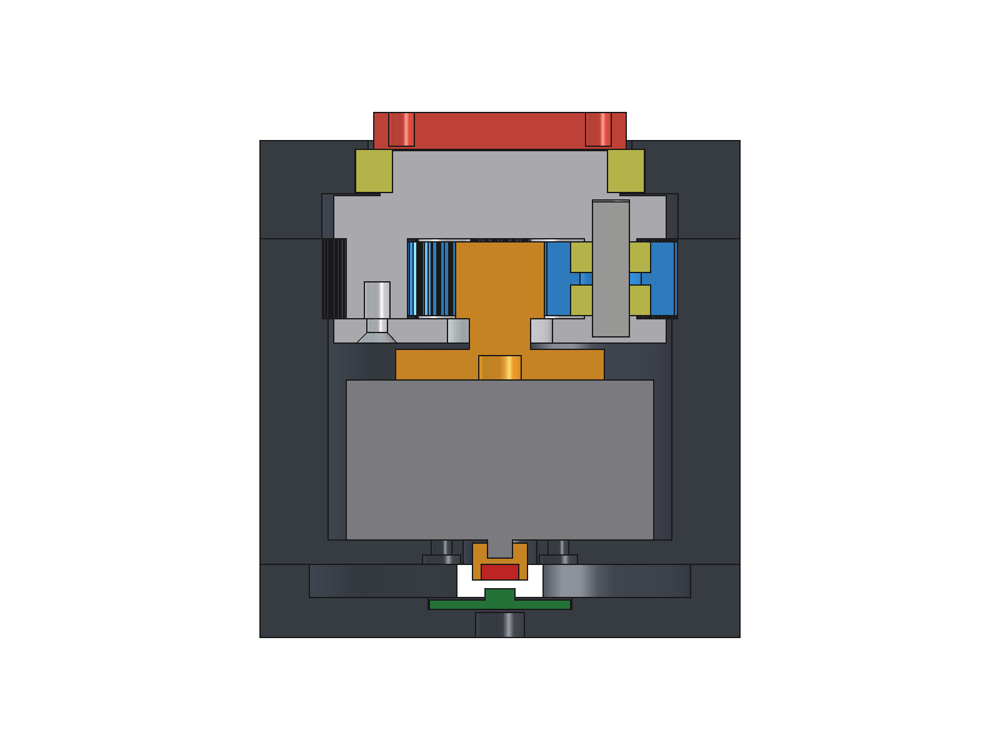

# QDD planetary actuator v1.0 — prototype

A compact brushless actuator: a 5010 drone motor driving a single-stage 6:1 planetary, with a
magnetic encoder on the rotor, in one Ø78 × 85 mm housing. Proof of concept for a
quasi-direct-drive robot joint, to be driven by a home-built FOC controller.

Original design for Bengaluru Tech Summit 2026. The architecture (BLDC + low-ratio planetary +
rotor encoder + torque control) follows Ben Katz's MIT Mini Cheetah actuator; Nate Twersky's
3D-printed version was a reference. No geometry was taken from either: every part here is
generated by `cad/build_actuator.py`.

## Specification

| | |
| --- | --- |
| Envelope | Ø78 × 85.3 mm (rear cap to output face) |
| Ratio | 6:1, fixed ring, sun in, carrier out |
| Gears | Spur, module 1.0, 20°, sun 12T / 3 planets 24T / ring 60T, 12 mm face |
| Profile shift | Sun +0.4, planets −0.4, ring −0.4 (standard 18 mm centre distance) |
| Design backlash | 0.08 mm of tooth thickness per gear (≈ 0.075 mm flank gap in CAD) |
| Motor | 5010 360 KV outrunner, 12N14P |
| Encoder | AS5600 on the motor shaft, 1.5 mm magnet gap |
| Output | Ø41 flange, 6 × M3 inserts on a 32 mm bolt circle |
| Bearings | 6 × 686 (planets), 1 × 6807 (output) |

Expected performance — **estimates, nothing is measured yet**. Kt = 60 / (2π · 360) = 0.0265 N·m/A;
gear efficiency assumed 80 %:

| Phase current | Output torque | Winding heat (1.5 · I² · 67 mΩ) |
| ---: | ---: | ---: |
| 5 A | 0.6 N·m | 2.5 W |
| 10 A | 1.3 N·m | 10 W |
| 20 A (motor limit) | 2.5 N·m | 40 W — short bursts only |

No-load output speed at 12 V ≈ 720 rpm.

## Measure the motor before printing two parts

The datasheet does not give these. Edit the value in `P` at the top of
`cad/build_actuator.py`, re-run it, and re-export.

| What to measure | Parameter | Current assumption | Affects |
| --- | --- | --- | --- |
| Bolt circle of the threaded holes on the rotor | `bell_slot_r` | Slots accept 16–25 mm bolt circles, 4 holes | `Sun_Gear` |
| Shaft length sticking out of the motor base | `shaft_out` | 3.0 mm | `Magnet_Cup`, `Rear_Cap_Encoder` |
| Rotor diameter and height | `motor_d`, `motor_h` | 50 × 26 mm | `Housing_RingGear`, whole stack |
| Base hole pattern | `motor_holes` | 19 mm and 16 mm, M3 | `Housing_RingGear` |

One robu.in reviewer reports a 6 mm shaft instead of 4 mm. Check `shaft_d` too.

## Print

Use the profile already calibrated for the cycloidal drive on the P1S: 0.2 mm layers, 5 walls,
hole expansion 0.07 mm, contour expansion 0.02 mm, Bambu PLA.

1. **Fit test first:** print `TEST_ring_slice.stl`, one `x3_Planet.stl` and `x1_Sun_Gear.stl`.
   The planet must roll between sun and ring by hand without binding. If it binds, raise
   `backlash` (0.08 → 0.12) and re-export.
2. Gears (sun, planets) at 100 % infill. Everything else 40–50 %.
3. Only `Carrier_Front_Output` needs supports (under the Ø54 plate).
4. Test a 686 and the 6807 in their seats before printing the rest; seats are nominal + 0.1 mm.

## Assemble

1. Set all 25 heat-set inserts.
2. Press two 686 bearings into each planet, one from each side.
3. Press the three Ø6 × 22 pins into `Carrier_Front_Output`, slide the planets on, fit
   `Carrier_Rear` and fasten with 3 × M3 × 8 countersunk. Each planet must spin freely.
4. Bolt `Sun_Gear` to the rotor (4 × M3 × 6). Do not use a power driver near the magnets.
5. Feed the motor wires through the base slot, bolt the motor into `Housing_RingGear` from behind.
6. Press the 6807 into `Front_Cover`. Press the carrier hub into the bearing and fasten
   `Output_Flange` (4 × M3 × 8) so the inner race is clamped.
7. Lower the cover-and-carrier assembly onto the housing, turning the output so the planets
   engage the sun and ring. Fasten with 6 × M3 × 16.
8. Glue the magnet into `Magnet_Cup`, press the cup onto the shaft end. Screw the AS5600 board
   into `Rear_Cap_Encoder` chip-side up, then fit the cap (4 × M3 × 14).
9. Turn the output by hand. It should back-drive the motor smoothly through a full turn.

## What has and has not been verified

Verified in CAD:
- No overlap between any two parts in the assembly.
- Sun–planet and planet–ring mesh stepped through one full tooth pitch (16 steps): no overlap,
  minimum flank gap 0.074–0.075 mm.
- All 13 exported STLs are watertight.

Not verified:
- Nothing is printed. Fits and backlash are nominal.
- No strength or thermal analysis. PLA softens near 55–60 °C and sits around a motor that can
  dissipate tens of watts at high current.
- The rotor bolt circle and shaft protrusion are assumptions (table above).
- The carrier is supported by the single 6807 and the gear mesh; there is no rear carrier bearing.
- Torque, efficiency and backlash figures are estimates until measured.

## Files

| Path | What |
| --- | --- |
| `cad/build_actuator.py` | Parametric source. Run inside FreeCAD to regenerate everything. |
| `cad/qdd_actuator_v1.0.FCStd` | FreeCAD assembly: printed, bought and bench-accessory groups |
| `cad/step/qdd_actuator_v1.0_assembly.step` | Whole assembly as STEP |
| `cad/stl/` | 13 STLs in print orientation, quantity in the file name |
| `cad/renders/` | Five images: on stand, actuator, gear train, encoder end, section |
| `BOM.md` | Printed parts, hardware, fasteners, electronics |
